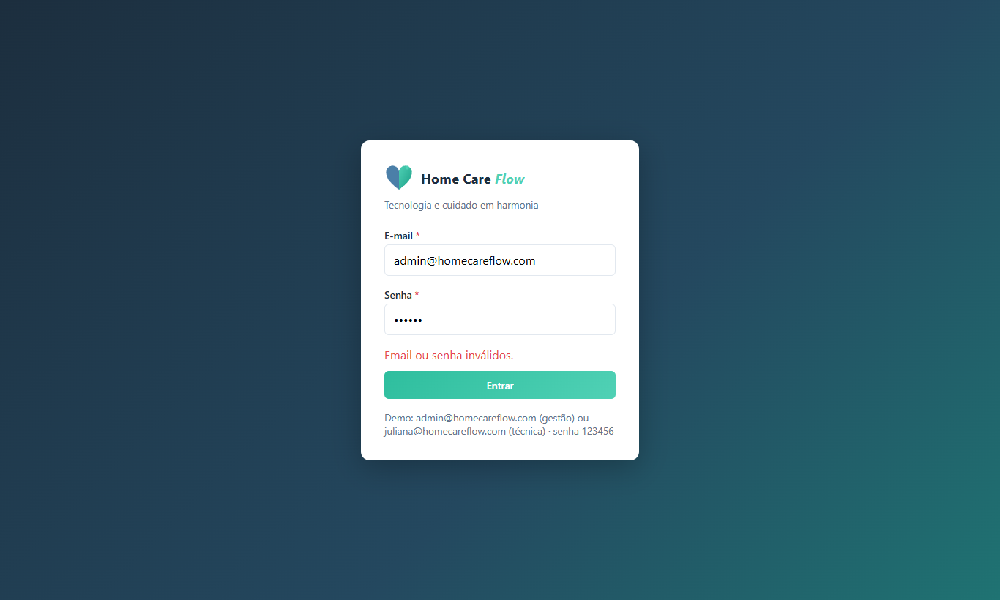
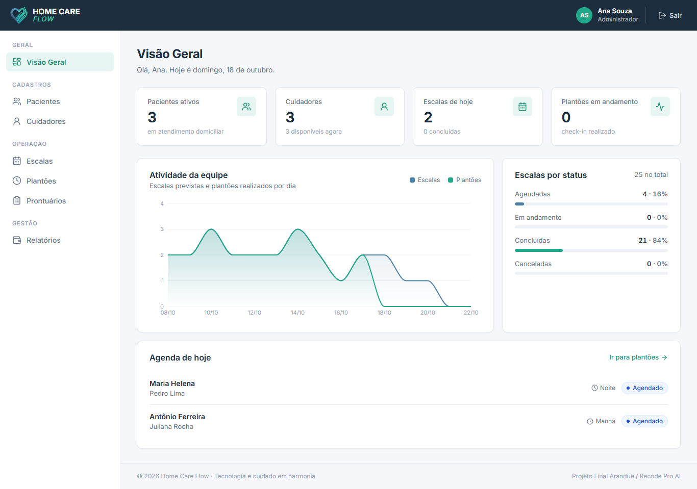
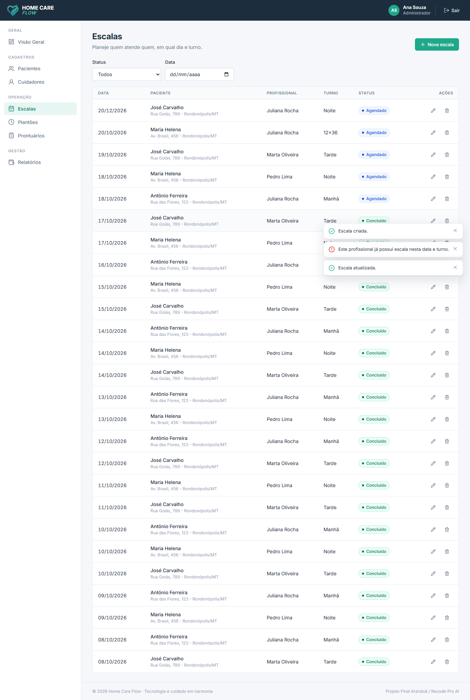
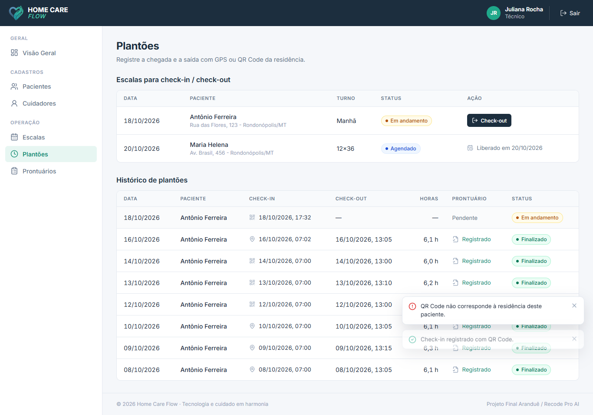
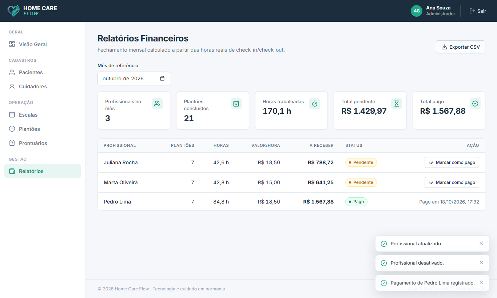
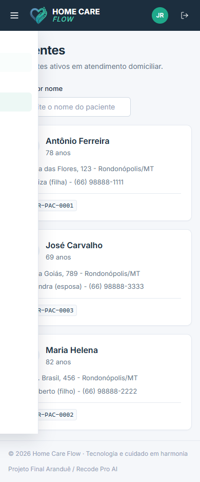
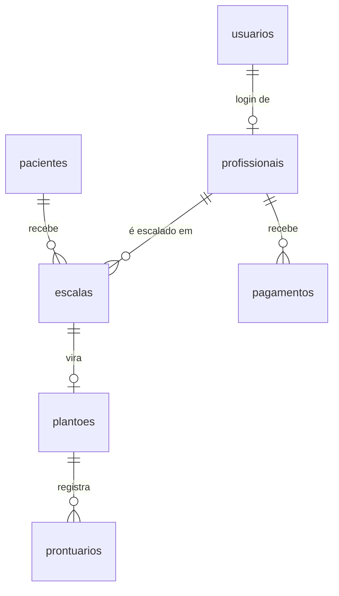

<p align="center">
  
</p>

<h1 align="center">Home Care Flow</h1>
<p align="center"><b>Tecnologia e cuidado em harmonia</b><br/>
Gestão de escalas, plantões e pagamentos para equipes de cuidado domiciliar.</p>

<p align="center">
  Projeto Final — Aranduê / Recode Pro AI · MySQL + Node.js + ReactJS
</p>

---

## Sumário
1. [Sobre o projeto](#1-sobre-o-projeto)
2. [Problema, ODS, público e impacto](#2-problema-ods-público-e-impacto)
3. [O que o sistema faz](#3-o-que-o-sistema-faz)
4. [Telas](#4-telas)
5. [Tecnologias](#5-tecnologias)
6. [Arquitetura](#6-arquitetura)
7. [Banco de dados](#7-banco-de-dados)
8. [API REST](#8-api-rest)
9. [Frontend e componentes](#9-frontend-e-componentes)
10. [Como rodar](#10-como-rodar)
11. [Próximos passos](#11-próximos-passos)
12. [Autor](#12-autor)

---

## 1. Sobre o projeto

O **Home Care Flow** é um sistema web para empresas e equipes de cuidado domiciliar (*home care*)
organizarem o trabalho dos seus profissionais: quem atende quem, em qual dia e turno, quando o
profissional chegou e saiu, o que aconteceu no plantão e quanto ele tem a receber no fim do mês.

> **Sobre o tema:** o edital restringe projetos de saúde. Pedi autorização para seguir com este tema
> e ela foi **concedida pelos gestores do curso**. O foco do sistema é a **gestão do trabalho** dos
> profissionais (escalas, jornada e pagamento), e não diagnóstico ou tratamento.
> Todos os pacientes cadastrados precisam ter **18 anos ou mais**.

## 2. Problema, ODS, público e impacto

### 💡 Problema
Em muitas equipes de home care tudo ainda é feito "na mão":
- o **ponto é anotado em papel**: dá margem para erro, perda e fraude de horário;
- as **anotações do plantão** ficam em cadernos, sem padrão e às vezes ilegíveis;
- o **pagamento é combinado pelo WhatsApp**, sem um registro confiável das horas trabalhadas.

Quem mais perde com isso é o profissional, que não tem como comprovar as horas que trabalhou.

### 🌎 ODS
- **ODS 8 — Trabalho Decente e Crescimento Econômico (principal):** o sistema formaliza a jornada
  dos cuidadores. O check-in e o check-out são registrados com **GPS ou QR Code da residência**,
  e o pagamento é calculado automaticamente sobre as **horas reais** (horas × valor da hora),
  com status pendente/pago.
- **ODS 10 — Redução das Desigualdades (complementar):** dá transparência e previsibilidade de
  renda para uma categoria em grande parte informal e mal remunerada.

### 👥 Público-alvo
- **Técnicos de enfermagem e cuidadores** (adultos) que trabalham por plantão;
- **Gestores e pequenas agências** de cuidado domiciliar.

### ❤️ Impacto esperado
- fim do ponto em papel e das discussões sobre horário;
- **pagamento justo e conferível**, baseado no tempo real de trabalho;
- histórico de atendimento **padronizado** e fácil de consultar;
- mais **profissionalização** para quem trabalha no setor.

## 3. O que o sistema faz

| Módulo | O que faz | Quem usa |
|---|---|---|
| **Escalas** (CRUD completo) | Cria, lista, filtra, edita e exclui escalas. Impede o mesmo profissional em duas escalas no mesmo dia e turno. | Admin / Gestor |
| **Pacientes** (CRUD completo) | Cadastro com busca. Cada paciente recebe um **código de QR Code** para a residência. | Admin / Gestor |
| **Cuidadores** (CRUD completo) | O cadastro já cria o **login do profissional** (usuário + profissional numa transação). | Admin / Gestor |
| **Plantões** | **Check-in** por GPS ou QR Code (só no dia da escala) e **check-out**. Histórico com horas. | Técnico (e gestão) |
| **Prontuário** | Registro padronizado do plantão (sinais vitais, medicação, intercorrências) e linha do tempo do paciente. | Técnico (e gestão) |
| **Financeiro** | Fechamento do mês (plantões, horas, valor), **marcar como pago** e **exportar CSV**. | Admin / Gestor |
| **Visão Geral** | Indicadores, gráfico de atividade, escalas por status e agenda do dia. | Todos |

**Perfis de acesso:**
- **Admin/Gestor:** cadastram, montam as escalas e acessam o financeiro.
- **Técnico:** vê só as escalas e plantões dele.

A regra vale **na API**, e não só na tela: mesmo chamando a API direto, um técnico não acessa dados de outro.

## 4. Telas

| Login | Visão Geral |
|---|---|
|  |  |
| **Escalas (CRUD)** | **Plantões (técnica)** |
|  |  |
| **Financeiro** | **Celular** |
|  |  |

## 5. Tecnologias

| Camada | Tecnologia |
|---|---|
| Banco de dados | **MySQL 8** (7 tabelas relacionadas, chaves estrangeiras, transações) |
| Backend | **Node.js + Express**, `mysql2`, `jsonwebtoken` (JWT), `bcryptjs`, `cors`, `dotenv` |
| Frontend | **ReactJS** (Vite), React Router, Axios, Recharts (gráfico), Lucide (ícones) |
| Nuvem | **Aiven** (MySQL), **Render** (API), **Vercel** (frontend) |

## 6. Arquitetura

```
┌──────────────────────┐   HTTP + JWT    ┌────────────────────────┐   SQL    ┌──────────────┐
│ React (Vercel)       │ ──────────────▶ │ API Node/Express       │ ───────▶ │ MySQL        │
│ pages → components   │ ◀────────────── │ routes → middlewares   │ ◀─────── │ (Aiven)      │
│ → services (axios)   │      JSON       │ → controllers → models │          │ 7 tabelas    │
└──────────────────────┘                 └────────────────────────┘          └──────────────┘
```

- **Backend em camadas:**
  - `routes` só define os caminhos;
  - `middlewares` cuidam do login e das permissões;
  - `controllers` validam os dados e aplicam as regras;
  - `models` fazem o SQL.
- **Frontend:**
  - `pages` são as telas;
  - `components` são as partes reutilizáveis;
  - `services` concentram as chamadas à API.

Mais detalhes em [docs/ARQUITETURA.md](docs/ARQUITETURA.md).

```
homecare-flow/
├── backend/            API Node.js (Express)
│   └── src/
│       ├── config/       conexão com o MySQL
│       ├── routes/       rotas da API
│       ├── middlewares/  autenticação, permissões e erros
│       ├── controllers/  validações e regras de negócio
│       ├── models/       consultas SQL
│       └── utils/        JWT, hash e script de criação do banco
├── frontend/           React (Vite)
│   └── src/
│       ├── pages/        telas
│       ├── components/   ui/, layout/ e um diretório por módulo
│       ├── services/     chamadas à API (axios)
│       ├── context/      login e avisos (toasts)
│       └── styles/       CSS e variáveis de cor
├── database/           schema.sql e seed.sql
└── docs/               arquitetura, deploy, roteiro da apresentação e telas
```

## 7. Banco de dados



| Tabela | Para que serve |
|---|---|
| `usuarios` | Login (admin, gestor, técnico) com senha criptografada (bcrypt) |
| `profissionais` | Dados de trabalho do cuidador: especialidade, valor/hora, disponibilidade |
| `pacientes` | Quem recebe o atendimento + código do QR Code da residência |
| `escalas` | Planejamento: paciente + profissional + data + turno + status |
| `plantoes` | Execução real da escala: horários e local de check-in/check-out |
| `prontuarios` | Registro padronizado de cada plantão |
| `pagamentos` | Fechamento mensal por profissional (único por profissional + mês) |

Scripts: [database/schema.sql](database/schema.sql) (estrutura) e [database/seed.sql](database/seed.sql)
(dados de demonstração com 10 dias de histórico).

## 8. API REST

Todas as rotas (menos o login) exigem o cabeçalho `Authorization: Bearer <token>`.

| Método | Rota | Descrição | Perfil |
|---|---|---|---|
| POST | `/api/auth/login` | Login, devolve o token JWT | público |
| GET | `/api/auth/me` | Dados do usuário logado | todos |
| GET | `/api/escalas?status=&data=` | Lista escalas (técnico: só as dele) | todos |
| GET | `/api/escalas/:id` | Detalha uma escala | todos |
| POST | `/api/escalas` | Cria escala | gestão |
| PUT | `/api/escalas/:id` | Atualiza escala | gestão |
| DELETE | `/api/escalas/:id` | Exclui escala (sem plantão) | gestão |
| GET/POST/PUT/DELETE | `/api/pacientes[/:id]` | CRUD de pacientes | leitura: todos · escrita: gestão |
| GET/POST/PUT/DELETE | `/api/profissionais[/:id]` | CRUD de profissionais | leitura: todos · escrita: gestão |
| GET | `/api/plantoes` | Lista plantões (técnico: só os dele) | todos |
| POST | `/api/plantoes/checkin` | Check-in por GPS ou QR Code | dono da escala / gestão |
| PUT | `/api/plantoes/:id/checkout` | Check-out | dono do plantão / gestão |
| POST | `/api/prontuarios` | Registra prontuário | dono do plantão / gestão |
| GET | `/api/prontuarios/paciente/:id` | Histórico do paciente | todos |
| GET | `/api/pagamentos/relatorio/:mes` | Calcula e grava o fechamento do mês | gestão |
| PUT | `/api/pagamentos/:id/pagar` | Marca pagamento como pago | gestão |

Os erros sempre voltam no formato `{ "erro": "mensagem" }`, com o status HTTP certo
(400 dados inválidos, 401 sem login, 403 sem permissão, 404 não encontrado, 409 conflito).

## 9. Frontend e componentes

As telas são montadas com componentes reutilizáveis, como o edital pede:

| Pedido no edital | Componente no projeto |
|---|---|
| Navbar | `layout/Navbar` (+ `Sidebar`, `Layout`, `Logo`) |
| Cards | `ui/Card`, `pacientes/CardPaciente` |
| Formulários | `ui/Input`, `escalas/FormularioEscala`, `pacientes/FormularioPaciente`, `profissionais/FormularioProfissional`, `prontuario/FormularioProntuario` |
| Botões | `ui/Button` (variantes primary, outline, danger, ghost…) |
| Tabelas | `ui/Table`, `escalas/TabelaEscalas`, `profissionais/TabelaProfissionais`, `financeiro/TabelaPagamentos` |
| Modais | `ui/Modal`, `ui/ModalConfirmacao`, `plantoes/ModalCheckinQr` |
| Footer | `layout/Footer` |

Também uso contexto (`AuthContext` para o login, `ToastContext` para os avisos) e um serviço
por recurso da API (`services/*Service.js`).

## 10. Como rodar

### Online
Acesse o link publicado (Vercel). A API gratuita do Render "dorme" depois de 15 minutos parada,
então o primeiro acesso pode levar até 1 minuto.

### No computador (Windows)
Pré-requisitos: **Node.js 18+** e **MySQL 8**.

1. Copie `backend/.env.example` para `backend/.env` e preencha `DB_USER` e `DB_PASSWORD`.
2. Dê dois cliques em **`preparar-banco.bat`**. Ele cria o banco com os dados de demonstração.
3. Dê dois cliques em **`iniciar.bat`**. Ele abre a API (porta 5000) e o site (http://localhost:3000).

<details>
<summary>Passo a passo manual (qualquer sistema)</summary>

```bash
cd backend
npm install
npm run db:setup     # apaga e recria o banco homecare_flow
npm run dev          # API em http://localhost:5000

cd ../frontend
npm install
npm run dev          # site em http://localhost:3000
```
</details>

O guia da publicação na nuvem está em [docs/DEPLOY.md](docs/DEPLOY.md).

### Usuários de demonstração (senha `123456`)
| Perfil | E-mail |
|---|---|
| Admin | admin@homecareflow.com |
| Gestor | carlos@homecareflow.com |
| Técnica | juliana@homecareflow.com |
| Técnico | pedro@homecareflow.com |

Códigos de QR das residências: `QR-PAC-0001`, `QR-PAC-0002` e `QR-PAC-0003`.

## 11. Próximos passos
- ler o QR Code pela câmera do celular (biblioteca `html5-qrcode`);
- validar a distância entre o GPS do check-in e o endereço do paciente;
- exportar o fechamento em PDF;
- troca e recuperação de senha;
- testes automatizados da API (Jest + Supertest);
- aplicativo mobile (PWA) para os cuidadores.

## 12. Autor

Desenvolvido por **[seu nome completo]** — GitHub [@ClaudeirZ2](https://github.com/ClaudeirZ2)
no Projeto Final da formação **Recode Pro AI — Aranduê**.

**Sobre o uso de IA:** usei o Claude (Anthropic) como assistente de programação, para tirar
dúvidas, revisar código e acelerar partes repetitivas. As decisões do projeto (tema, regras de
negócio, modelagem e identidade visual) e os testes são meus.

Atenção (LGPD): todos os dados do sistema são **fictícios**. Dados de saúde são sensíveis,
por isso o sistema usa login com JWT, senhas com bcrypt e controle de acesso por perfil.
